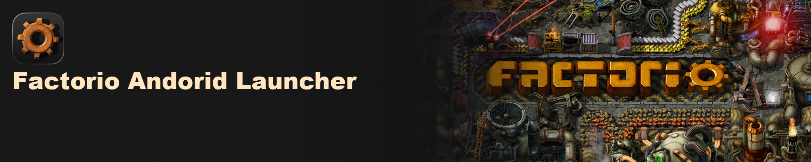

# Factorio Android Launcher



[](https://github.com/PlutoCRown/FactorioAndroid/actions/workflows/release.yml)
[](https://github.com/PlutoCRown/FactorioAndroid/releases/latest)
[](https://github.com/PlutoCRown/FactorioAndroid/releases)
[](https://github.com/PlutoCRown/FactorioAndroid/stargazers)
[](LICENSE)


[简体中文](README.md) | **English**

Run your own official Linux ARM64 Factorio on Android. This is an unofficial launcher and is not affiliated with Wube Software.

## About

### Introduction

The launcher runs the official Linux ARM64 graphical client through a GNU/Linux runtime, Mesa Zink and the device’s Vulkan driver, presenting its output on an Android Surface.

> This project does not include or distribute Factorio game files. You need your own copy downloaded from the official website, preferably purchased and downloaded through your Factorio account. Import the game package into the launcher to start playing.

### Features

- Run the full Linux ARM64 graphical client, with support for both the base game and the Space Age DLC.
- Run ARM64 game code natively, without CPU instruction translation, with mainstream chips capable of running late-game factories.
- Import saves and adjust graphics settings; saves and mods work across platforms.
- Forward keyboard, mouse and touch mouse input, with an on-screen virtual gamepad also available.

## How to play

1. Open [Releases](https://github.com/PlutoCRown/FactorioAndroid/releases), download this app, and install it. Choose the standard APK for the launcher release you want.
2. Sign in at [factorio.com](https://factorio.com/). If you bought the game on Steam, follow the [official FAQ](https://factorio.com/support/faq) to link Steam to your Factorio account.
3. On the [official download page](https://factorio.com/download), choose **Linux ARM64**. If that version is not listed, switch to the experimental channel beside it. For Space Age, download only the Space Age package; you do not need to download the base game as well.
4. Put the original archive somewhere the Android file picker can open. On the launcher home screen, choose **Select game package**. Do not unpack it first.
5. Choose **Launch game**.

## Requirements

- A 64-bit ARM Android device running Android 8.0 (API 26) or later.
- Memory: 12 GB RAM recommended for the base game (8 GB minimum); 16 GB recommended for Space Age (12 GB minimum).
- Storage: leave at least 4 GB free for the base game, or 8 GB for Space Age.
- CPU: Snapdragon 8 Gen 1 or a processor with comparable or better performance is recommended.

Compatibility: multiple game versions, including 2.0 and 2.1, have been tested on Snapdragon 8 Gen 2 and XRING O3 chips.

> Test save: Space Age with four planets unlocked, producing 1,000 science packs per minute for all science types except military (black) science.
>
> - Redmi K70 (Snapdragon 8 Gen 2), rendering at 2400×1080: 60 UPS, with FPS varying between 20 and 40 depending on zoom level.
> - Xiaomi Pad 9 Pro Max (XRING O3), rendering at 2400×1080: 60 UPS, with FPS varying between 20 and 40 depending on zoom level.
>
> The author has access to only a few devices. Please share your test results in [Issues](https://github.com/PlutoCRown/FactorioAndroid/issues).

## Controls and configuration

1. An external keyboard and mouse or a gamepad is recommended. The project also provides an on-screen virtual gamepad.
2. Crashes during play are often caused by memory pressure. Before launching, choose the **4K textures** preset and limit texture-loading threads (the lowest setting is recommended; it slows loading slightly without affecting gameplay). Shorten the autosave interval to reduce lost progress, ~~or spend more on a device with at least 24 GB RAM~~. Common crash scenarios include:

   - The 50%–90% stage of game startup.
   - Creating a map.
   - Switching between planet or space platform surfaces in remote view.

3. The game does not support simultaneous keyboard and gamepad input. If several devices are connected, select the input device in the game’s control settings.

   - When the virtual gamepad is enabled, the game starts with gamepad input selected.
   - With keyboard input selected and touch mouse emulation enabled, swipe vertically with two fingers to scroll containers.
   - Use Android’s back gesture in place of the Esc key, especially when a large window’s close button is out of reach.
   - Focusing a text field opens the Android keyboard. Dismiss it before continuing to use touch controls.

## Development

> This project was built with a lot of wishful programming and still has plenty of room for optimization. Contributions are welcome.

See [Project structure and development conventions (Chinese)](docs/DEVELOPMENT.md) for source layout, formatting commands and test entry points. See [Mesa compatibility builds (Chinese)](docs/MESA-COMPATIBILITY.md) for graphics runtime source, patches, build instructions and reuse.

See [Native library origins and download instructions (Chinese)](docs/NATIVE-LIBRARIES.md) for each packaged `.so`, its role, download location, original archive member and extraction steps. It also covers XKB data, additional Compose/AndroidX libraries and the keyboard request helper. See [Android keyboard integration (Chinese)](docs/ANDROID-KEYBOARD.md) for keyboard activation, text delivery and native helper build instructions.

Build requirements: JDK 17+, SDK platform 36 and Build Tools 36.0.0. AGP 9.0.1 supplies Kotlin 2.2.10; Gradle 9.1.0 and Compose BOM 2026.01.00 are pinned. The wrapper JAR and Gradle distribution have fixed SHA-256 checksums. The app uses minSdk 26 and targetSdk 36.

On Windows, prepare a project-local toolchain if the existing JDK/SDK is too old:

```powershell
powershell -NoProfile -ExecutionPolicy Bypass -File .\scripts\prepare-windows-toolchain.ps1
powershell -NoProfile -ExecutionPolicy Bypass -File .\scripts\build-windows.ps1 -PerformancePackage
```

JDK/SDK tools go under `tools/`, and downloads/Gradle state under `.cache/`. No system installation or persistent environment changes. To reuse compatible existing tools, pass `-Jdk` and `-Sdk` to the build script instead.

On Linux x86_64 or macOS with JDK 17+ and an Android SDK:

```bash
JAVA_HOME=/path/to/jdk ANDROID_HOME=/path/to/sdk ./scripts/build.sh --performance-package
```

Zig 0.15.2 for input adapters downloads automatically on Linux x86_64 and macOS. The standard package is `dev.plutocrown.factorio`; the optional performance package is `com.miHoYo.Yuanshen`. Both APKs and `build-result.json` are in `artifacts/`. Both scripts run Gradle unit tests (existing checks plus keyboard request/composition checks) and verify signatures, alignment, package identities, the pinned runtime libraries, XKB, the AndroidX path library and the native components generated from source inside each APK. The compile-only JNI annotation stub is not packaged. Verified third-party runtime libraries are neither rebuilt nor stripped by Gradle. The Vulkan ICD, keyboard request helper, SDL input-method adapter and gamepad adapter are compiled from source during the build using project-local Zig 0.15.2; see the keyboard instructions.

Both entry points restore the pinned runtime automatically. To restore separately (JDK 11+):

```bash
java scripts/RestoreRuntime.java
```

Offline restore: `java scripts/RestoreRuntime.java --archive /path/to/factorio-android-runtime-arm64-20261021-v1.zip`. Use `--check` to verify existing files, or `--force` to explicitly replace changed files. This restores prebuilt dependencies rather than rebuilding all upstream components.

Signing uses the existing project-local key or CI secrets; a key is generated if none is configured. Keep the same signing key for future upgrades. Application tags build and publish APKs to Releases; `runtime-` tags are reserved for pinned dependencies. To publish manually, use Actions → Release → Run workflow and fill `release_tag` with the new application version. Leave it empty to only build Actions artifacts. Existing tags are not moved.

The Release body comes from `docs/releases/<factorioVersionName>.md`. Commit the matching notes with each version update. The workflow selects the notes using the actual APK version in `gradle.properties`, rather than tag annotations. See [Versioned release notes (Chinese)](docs/releases/README.md). For how cloud builds generate and package the additional graphics libraries, see [Mesa compatibility builds (Chinese)](docs/MESA-COMPATIBILITY.md#github-actions-如何取得新增库).

## License

The project-owned launcher, native adapters, tests, and build scripts are [GPL-3.0-or-later](LICENSE), Copyright (C) 2026 Pluto_CRown. Third-party components keep their own licenses. See [THIRD-PARTY-NOTICES.md](THIRD-PARTY-NOTICES.md).

## GitHub Star History

[](https://www.star-history.com/#PlutoCRown/FactorioAndroid&Date)

For every project-owned or modified native component, source inputs, build commands and output paths are documented in [SOURCE-BUILD.md](docs/SOURCE-BUILD.md).
